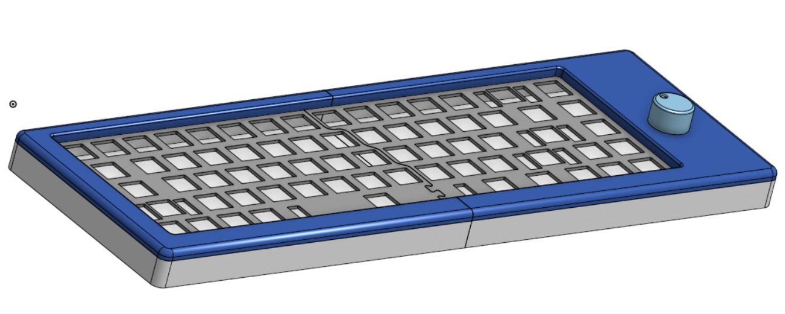

### Case 

The case houses the PCB and keyboard components. I used a sandwhich mount, where the plate sits between the top case and the bottom case, anchored by screws. For this case, I used M2.5 screws and corresponding heatset inserts. Originally, I had wanted the PCB to be up in the top with the knob in the top left, but after my second iteration, I chose to put it on the side so that the case would be smaller in total. I did consider making the PCB accessible/viewable but decided against it. I can always reprint the case if I want to have a clear viewing section. I used a keyboard plate generator to make the sketch for the plate. To split the case for printing, there are pins and holes the top and bottom parts of the case, and a puzzle piece cutout for the plate. At the bottom there are feet that house rubber pads. 