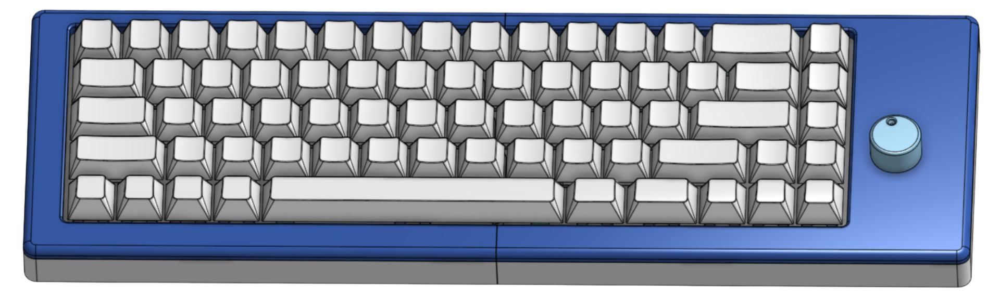

# Keyz
My custom 65% mechanical keyboard as part of [Hack Club's Keeb YSWS](https://keeb.hackclub.com/). Hours spent is in the [Journal.md](Journal.md)

## Description

My keyboard "Keyz" is a 65% mechanical keyboard powered by a Raspberry Pi Pico microcontroller. It uses the classic Gateron Quinn switches for a subtle tactile click, and is intended to be minimalistic with a compact layout while also providing the full functionality that an average keyboard user would need. It uses a sandwich mount to house the PCB, and features a rotary encoder to be used as volume control.

## Why I made it

I made this keyboard not because I percisely needed one, but because I had always dreamed of having a mechanical keyboard, but having a laptop did not pose a need to purchase one. Instead, I decided to create one instead. Another reason I chose to create this keyboard is because I am very interested in learning more about electronics and hardware, so I thought making a keyboard would be one of the best ways to get my feet wet. Anyways, this keyboard inspired me to make more projects, because it was so satisfying to go through the steps and end up with a full keyboard (at least in Onshape, I haven't actually built it yet). 

## Learning process

I learnt so much through the process of making this keyboard. I started off this project knowing absolutely nothing about keyboards at all, and know I have learnt how they work, the inner mechanisms, different types of casing, and how they are wired. In addiition, I also didn't know anything about KiCad before this project, but making this keyboard gave me a chance to learn how making a PCB works from the schematic to wiring up all the connections. It kinda surprised me how crazy the initial schematic to PCB stage was (it was VERY messy), and I was completely overwhelmed by the number of wires and connections. However, I managed to get through it and would consider myself having a solid beginner-level understanding of KiCad! I already knew about Onshape, but I definitely explored some new features in this project, like editing in context. 

Another thing this project taught me was how iterative the engineering process is, because I had a major hiccup when I thought I was almost done and got to buying keycaps, I realized that my switch sizes were not standard, and would entail 3d printing custom keycaps, which I didnt like the quality of. So I had to basically repeat the whole project with the schematic and the PCB to change the layout so that my keycap sizes were standard and fit the keycap set I was buying. 

Overall, this project was incredibly fun and taught me so much that I hope to apply in future projects. 

## Bill Of Materials 

[Link](https://docs.google.com/spreadsheets/d/1fL_IQgmIi_XlOX9ydgWSfowry5usrP5Ks7BfyhSlTqM/edit?gid=0#gid=0) to the BOM in Google Sheets with most updated info. 

| Category | Item | Quantity | Unit Cost (CAD) | Total Cost (CAD) | Total Cost (USD) | Supplier |
|---|---|---:|---:|---:|---:|---|
| Electronics | EC11 Rotary Encoder | 1 | $4.44 | $4.44 | $3.22 | [DigiKey](https://www.digikey.ca/en/products/detail/bourns-inc/PEC11R-4215K-S0024/4499662) |
|  | 1N4148 Diode | 100 | $0.54 | $5.43 | $3.93 | [DigiKey](https://www.digikey.ca/short/thzf78m3) |
|  | Raspberry Pi Pico | 1 | $5.65 | $5.65 | $4.09 | [Pishop](https://www.pishop.ca/product/raspberry-pi-pico-non-wireless/?src=raspberrypi) |
|  | Header Set | 1 | $2.45 | $2.45 | $1.77 | [Pishop](https://www.pishop.ca/product/raspberry-pi-pico-header-set/) |
| PCB | PCB | 5 | $5.74 | $28.70 | $20.79 | JLCPCB |
| Case accessories | M2.5 Heatset Insert | 6 | $0.29 | $1.74 | $1.26 | [DigiKey](https://www.digikey.ca/short/qzncdpv7) |
|   | M2.5 Screw | 6 | $0.18 | $1.10 | $0.80 | [DigiKey](https://www.digikey.ca/short/h5w2dz84) |
|   | Rubber Pads | 10 | $0.42 | $4.20 | $3.04 | [AliExpress](https://www.aliexpress.com/item/1005009215190070.html) |
| Keyboard | Gateron Quinn Switches | 2 | $25.92 | $51.84 | $37.56 | [Best Buy](https://www.bestbuy.ca/en-ca/product/gateron-quinn-keyboard-switches-tactile-59gf-rgb-5-pin-pre-lubed-for-mx-mechanical-gaming-keyboard-35pcs/19677735) |
|  | MX Stabilizers | 1 | $12.39 | $12.39 | $8.98 | [AliExpress](https://www.aliexpress.com/item/1005011961905061.html?pdp_ext_f=%7B%22order%22%3A%224%22%2C%22spu_best_type%22%3A%22price%22%2C%22eval%22%3A%221%22%2C%22fromPage%22%3A%22search%22%7D) |
|  | Keycaps | 1 | $33.89 | $33.89 | $24.55 | [Amazon](https://www.amazon.ca/KBDiy-Keycaps-Percent-Mechanical-Keyboard/dp/B0CT5C2B8F/ref=sr_1_12?crid=1G9HY1UQNN4EB&dib=eyJ2IjoiMSJ9.clPrYS9Mkyt7Ng5yimc05HMOhgR_GEZWlov_hXIkV9-_h0WDo9gYInM0Yk9tMJwczcDFMajBQryI1t6EV9p5ITevjSiprSjUviSEQx3G5hNPEWnSzGRGL956B40tmiqJm-n2AawS38tOLG-GFsVDaeSjmj9awOJeDdH045WScT0GTN6IsGh-ItvRhL_881FHrDxEOcqkqGO3Dg4sBr-J1XczmzxubBDGn-RJNlNZkypSSrn-67t4XAXXBuu6ufBuBYeUX3MqzMp8gpuCwUrFE91R8SOQ8tcxfq_Ag4yXTtg.RBzHkodv9L72tgKA8IOQ7Xk_Ys0xNDpOGra9LuzEhMY&dib_tag=se&keywords=blue%2Bkeycap%2Bset&qid=1786037838&s=electronics&sprefix=blue%2Bkeycap%2Bset%2Celectronics%2C122&sr=1-12&th=1) |
| Shipping | Pishop Shipping | — | $13.01 | $13.01 | $9.43 | Pishop |
|  | JLCPCB Shipping | — | $41.67 | $41.67 | $30.19 | JLCPCB |
|  | DigiKey Shipping | — | $15.00 | $15.00 | $10.87 | DigiKey |
|  | AliExpress Shipping | — | $7.34 | $7.34 | $5.32 | AliExpress |
| **Total** | | | | **$228.85 CAD** | **$165.79 USD** | |

